# Claude Windows Computer Use — Background-First OS Automation & FastMCP 🖥️🤖⚡

[-D97706?logo=anthropic&logoColor=white)](https://anthropic.com)
[](https://modelcontextprotocol.io/)
[](https://microsoft.com/windows)
[](https://github.com/pironjulien/claude-windows-computer-use)
[](LICENSE)
[](https://julienpiron.com)

> **High-performance, background-first Windows OS Computer Use and FastMCP server engineered specifically for Anthropic Claude Code and Claude Desktop.**
>
> 🚀 **Operate Windows desktop applications silently in the background while keeping your physical mouse, keyboard, and foreground window completely undisturbed.**

---

## ⚡ Why Claude Windows Computer Use?

Anthropic introduced Computer Use in API beta primarily on Linux Docker containers and macOS. For developers and teams working on Windows — including Claude Desktop, Pro, and Team subscribers — no native out-of-the-box solution existed. In enterprise workflows, engineers cannot afford to have their physical mouse cursor hijacked, their active terminal interrupted, or their screen taken over.

`claude-windows-computer-use` solves this with a native, **background-first architecture** via FastMCP:

| Dimension | Conventional Screen-Capture Automation | **Claude Windows Computer Use (`nexus-windows`)** |
| :--- | :--- | :--- |
| **Execution Mode** | Forced foreground window takeover | **100% Background-First** (Operates occluded & covered windows) |
| **Mouse Interaction** | Physical cursor hijacked across screen | **Zero Cursor Movement** (Direct Win32 & UI Automation COM invocation) |
| **Keyboard Interaction** | Blind keystroke injection | **Direct Buffer Setting** (`EM_REPLACESEL`, `ValuePattern`) without focus theft |
| **User Interference** | Fights user input and crashes | **Raw Input Yield** (Restores user focus in ~10 ms upon any physical key/mouse stroke) |
| **Clipboard Safety** | Uses and clobbers system clipboard | **Zero Clipboard Dependency** (Never touches Windows clipboard) |
| **Safety & Redlines** | Unrestricted access to system | **Strict Policy Guard (`policy.py`)** + Global Emergency Stop (`Ctrl+Alt+Shift+Esc`) |
| **Protocol** | Generic screenshot guessing | **Native Model Context Protocol (FastMCP)** with atomic batch actions (`act`) |

---

## 🏛️ Empirical Architecture: 6 Windows Frameworks Measured

Benchmarked across 6 major Windows UI technologies (see [`bench/RESULTS.md`](bench/RESULTS.md)):

```mermaid
flowchart TD
    Claude["Anthropic Claude<br/>Claude Code / Claude Desktop"] -->|"Model Context Protocol (FastMCP)"| MCPServer["nexus-windows Server<br/>FastMCP Runtime"]
    
    subgraph Engine ["Background Execution Engine"]
        Router{"UI Framework Detection"}
        
        Router -->|"Win32 Native"| Win32["Direct Win32 Message Dispatch<br/>BN_CLICKED, CB_SETCURSEL, EM_REPLACESEL"]
        Router -->|"WinForms / WPF / WinUI"| UIA["COM UI Automation Patterns<br/>TogglePattern, ValuePattern, InvokePattern"]
        Router -->|"Chromium / Electron"| Chromium["Render Accessibility & DevTools Bridge<br/>Zero Occlusion Calculation"]
        
        Capture["Offscreen GDI & PrintWindow<br/>PW_RENDERFULLCONTENT"]
        RawInput["Hardware Raw Input Watcher<br/>Yields in ~10ms on user activity"]
        Policy["Strict Policy Engine<br/>Protects passwords, UAC, consoles, explorer"]
    end
    
    MCPServer --> Engine
    Win32 --> Target["Target Application Window<br/>Background / Occluded"]
    UIA --> Target
    Chromium --> Target
    
    style Engine fill:#1e1e2e,stroke:#d97706,stroke-width:2px
    style Target fill:#11111b,stroke:#2ea44f,stroke-width:2px
```



### The Core Pillars

1. **Native Win32 Direct Messaging**:
   - Buttons, checkboxes, dropdowns, and tabs receive direct messages (`BN_CLICKED`, `CB_SETCURSEL`, `TCM_SETCURFOCUS`). UI Automation is bypassed where it would otherwise steal focus.
2. **WinForms, WPF, UWP & WinUI 3**:
   - UI Automation patterns (`AutoSetFocus` explicitly disabled) with deterministic timeouts.
3. **Chromium & Electron Applications**:
   - Headless DevTools execution and forced accessibility rendering (`--disable-features=CalculateNativeWinOcclusion --force-renderer-accessibility`), allowing background operation without visual rendering degradation.
4. **Offscreen Capture Guard**:
   - Direct `PrintWindow` capture (10–25 ms) strictly calibrated for Claude multimodal token budgets ($\le 1568$ px and $1.15$ Mpx) so coordinates remain 1:1 pixel-accurate without downsampling.
5. **Physical Raw Input Safety**:
   - Monitors physical keyboard and mouse input without hooks. If the user touches a key or moves the mouse during an action, Claude immediately halts and yields the foreground.

---

## 🛡️ Enterprise Safety & Security

- 🛑 **Global Hardware Kill Switch (`Ctrl + Alt + Shift + Esc`)**:
  - Immediately aborts any ongoing action at the next checkpoint. Blocks all actions for 2 minutes across all active sessions.
- 🔒 **Zero-Trust Policy (`policy.py`)**:
  - Automatically denies interaction with password managers, UAC credential dialogs, Windows Terminal / PowerShell consoles, Claude interfaces, the Start Menu, and Taskbar.
  - Password inputs are strictly blocked; entered text is never logged or mirrored.
- 📋 **Zero Clipboard Pollution**:
  - Does not read, overwrite, or touch the user's system clipboard.

---

## 🛠️ MCP Tool Reference

| Tool | Parameters | Description |
| :--- | :--- | :--- |
| `windows` | `filter: str = ""` | Enumerates application windows from front to back with HWND, title, process name, and UI framework family. |
| `look` | `window: int, show: bool, marks: bool...` | Extracts interactive controls with Set-of-Marks `[N]` badges and an offscreen screenshot without foreground theft. |
| `act` | `steps: list, window: int, foreground: bool` | Executes multiple actions atomically in a single turn with live readback verification. |
| `launch` | `app: str, args: list, devtools: bool` | Launches desktop apps (Start Menu, Store, executable) safely in the background. |
| `window` | `action: str, window: int...` | Manages window geometry (restore, minimize, maximize, close, move, resize). |
| `logs` | `count: int, errors_only: bool` | Returns diagnostic logs (techniques attempted, latencies, errors, server state). |

---

## 🚀 Quickstart & Setup

### 1. Installation

```bash
git clone https://github.com/pironjulien/claude-windows-computer-use.git
cd claude-windows-computer-use
uv sync
```

*Or install via pip:*
```bash
pip install -e .
```

### 2. Add to Claude Code

```bash
claude mcp add nexus-windows -- python -m nexus_windows.server
```

### 3. Add to Claude Desktop

Add to `%APPDATA%\Claude\claude_desktop_config.json`:

```json
{
  "mcpServers": {
    "nexus-windows": {
      "command": "python",
      "args": [
        "-m",
        "nexus_windows.server"
      ],
      "cwd": "C:/Dev/claude-windows-computer-use"
    }
  }
}
```

### 4. Run the Test Suite

```bash
uv run pytest tests/test_contract.py -v
```
*(64 contract verification tests covering framework dispatch, raw input yields, emergency stop, and policy redlines).*

---

## 👨‍💻 Author & License

Architected with symbiotic precision by **Julien Piron** ([julienpiron.com](https://julienpiron.com) • [julienpiron.fr](https://julienpiron.fr) • X: [@julienpironfr](https://x.com/julienpironfr)).

Published under the **MIT License**.
