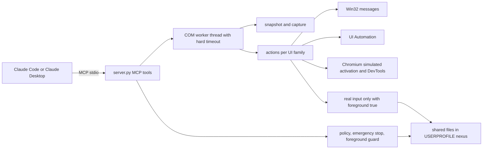

# NexusWindows for Claude

<!-- mcp-name: io.github.pironjulien/nexus-windows-claude -->

[](https://github.com/pironjulien/NexusWindows-Claude/releases)
[](https://pypi.org/project/nexus-windows-claude/)
[](https://github.com/pironjulien/NexusWindows-Claude/actions/workflows/tests.yml)
[](https://scorecard.dev/viewer/?uri=github.com/pironjulien/NexusWindows-Claude)
[](https://github.com/pironjulien/NexusWindows-Claude/blob/main/LICENSE)
[](https://github.com/pironjulien/NexusWindows-Claude/blob/main/pyproject.toml)
[](https://modelcontextprotocol.io)
[](#installation)

[](https://julienpiron.fr/nexuswindows/)


**Windows computer use for Claude, in the background.** An MCP server (`nexus-windows-claude`) that lets Claude Desktop
and Claude Code see and operate Windows desktop applications while the user keeps their mouse, keyboard and
foreground window.

Version 3.0.1 · Windows 10/11 · Python 3.14 · MIT licence

Part of the Nexus family: [NexusWindows](https://julienpiron.fr/nexuswindows/)
([Claude](https://github.com/pironjulien/NexusWindows-Claude) ·
[Codex](https://github.com/pironjulien/NexusWindows-Codex) ·
[Antigravity](https://github.com/pironjulien/NexusWindows-Antigravity)),
[NexusBrowser](https://julienpiron.fr/nexusbrowser/) ([repo](https://github.com/pironjulien/NexusBrowser)),
[NexusAndroid](https://julienpiron.fr/nexusandroid/) ([repo](https://github.com/pironjulien/NexusAndroid)).
Project page: [julienpiron.fr/nexuswindows](https://julienpiron.fr/nexuswindows/).

## Why

Anthropic's own computer use (in Cowork and Claude Code inside Claude Desktop) is a beta for Pro and Max
subscribers: "Team and Enterprise plans don't have access to computer use at this time"
([Claude Help Center](https://support.claude.com/en/articles/14128542-let-claude-use-your-computer-in-cowork)).
NexusWindows for Claude is a local MCP server, so it works with Claude Desktop and Claude Code on any plan that
allows local MCP servers, Team and Enterprise included.

Screenshot-and-click computer use moves the real cursor and brings windows to the front, so the person at the PC has
to stop working while the agent acts. Most Windows applications can be driven without that: native controls accept
window messages, modern frameworks expose UI Automation, and Chromium can be reached through its accessibility tree.
This server picks, per UI family, a technique that was **measured** not to steal focus, reads the effect back, and
only falls back to the real mouse or keyboard when the user explicitly allows it.

## NexusWindows family

Three MCP servers, one per agent, built separately because each model needs its tools shaped for it, with the same
promise: the user keeps their mouse, keyboard and foreground window, and every action is read back.

| | Claude | Codex | Antigravity |
|---|---|---|---|
| Install | `uvx --python 3.14 nexus-windows-claude` | `npx -y nexus-windows-codex` | `uvx --python 3.14 nexus-windows-antigravity` |
| Package | [PyPI](https://pypi.org/project/nexus-windows-claude/) | [npm](https://www.npmjs.com/package/nexus-windows-codex) | [PyPI](https://pypi.org/project/nexus-windows-antigravity/) |
| Tools | `windows` `look` `act` `launch` `window`, plus `notifications` and `logs` | `windows` `look` `act` `launch` `window` | `windows` `look` `act` `launch` `window` |
| Repository | [NexusWindows-Claude](https://github.com/pironjulien/NexusWindows-Claude) | [NexusWindows-Codex](https://github.com/pironjulien/NexusWindows-Codex) | [NexusWindows-Antigravity](https://github.com/pironjulien/NexusWindows-Antigravity) |

Every step reports ✓ verified, = already done, ~ unknown (never replayed) or ✗ failed or refused. The three share the
guardrail policy, the foreground token, the emergency stop (Ctrl+Alt+Shift+Esc), a common journal format and a common
bench.

## Installation

Requirements: Windows 10 or 11, [uv](https://docs.astral.sh/uv/), Python 3.14.

From [PyPI](https://pypi.org/project/nexus-windows-claude/), with Claude Code (no clone needed):

```powershell
claude mcp add --scope user -e PYTHONUTF8=1 --transport stdio nexus-windows -- uvx --python 3.14 nexus-windows-claude
```

Until 3.0.0 the package was named `nexus-windows`; that name still works and installs `nexus-windows-claude`.

For Claude Desktop, in `claude_desktop_config.json`:

```json
{
  "mcpServers": {
    "nexus-windows": {
      "command": "uvx",
      "args": ["--python", "3.14", "nexus-windows-claude"],
      "env": { "PYTHONUTF8": "1" }
    }
  }
}
```

From a clone (development):

```powershell
git clone https://github.com/pironjulien/NexusWindows-Claude.git
cd NexusWindows-Claude
$env:UV_PROJECT_ENVIRONMENT = "$env:LOCALAPPDATA\claude-windows-computer-use\venv"   # optional: venv outside the clone
uv sync --frozen
```

Register it with Claude Code (user scope):

```powershell
claude mcp add --scope user `
  -e "UV_PROJECT_ENVIRONMENT=$env:LOCALAPPDATA\claude-windows-computer-use\venv" -e PYTHONUTF8=1 `
  --transport stdio nexus-windows '--' uv run --project "$PWD" --frozen python -m nexus_windows
```

For Claude Desktop from a clone:

```json
{
  "mcpServers": {
    "nexus-windows": {
      "command": "uv",
      "args": ["run", "--project", "C:/path/to/NexusWindows-Claude", "--frozen", "python", "-m", "nexus_windows"],
      "env": { "PYTHONUTF8": "1" }
    }
  }
}
```

Local state (logs, routines) lives in `%USERPROFILE%\.claude\nexus-claude\`; set
`NEXUS_WINDOWS_HOME` to use another folder.

## Tools

| Tool | Purpose |
|---|---|
| `windows(filter)` | Application windows, front to back: hwnd, title, process, UI family, size; `[hidden]` Store apps launched in the background (never shown, still drivable); then the taskbar and the desktop |
| `look(window, show, query, region, detail, marks)` | Numbered `[N]` elements (role, name, value, state, position) plus an image, without bringing the window forward; also `window="taskbar"`, `"desktop"`, and `"screen"` (the whole screen with each window's place) |
| `act(steps, window, then, foreground, remember, routine, params)` | Several steps in one call, each read back, then the updated state; Windows panels `"quick settings"`, `"notifications"`, `"start"` with `foreground=true` |
| `launch(app, args, devtools, restart)` | Start an application (Start menu name, Store app, executable), a folder, a document or an address (`ms-settings:<page>`, `mailto:`, `https:`) without giving it focus; the opening is verified |
| `window(action, ...)` | Restore behind, minimize, maximize, close, move, resize |
| `notifications(limit, app)` | Windows notifications read from their database (read-only), nothing opened on screen; security codes masked |
| `logs(count, errors_only)` | Debug log: techniques tried, durations, errors, server state |

Step actions: `click`, `double_click`, `right_click`, `type`, `set`, `clear`, `key`, `select`, `check`, `uncheck`,
`toggle`, `expand`, `collapse`, `scroll`, `focus`, `menu`, `wait`, `drag`, `hover`. A target is an `[N]` from the last
`look`, a visible name (`"OK"`), a role-qualified name (`"button:OK"`, `"edit:Name"`, `"checkbox:Subscribe"`) or an
`x,y` point in the last image.

## Usage

Typical flow: `look(window="Notepad")`, then one `act` with all the steps, then read the per-step report.

```text
act(window="Settings form", steps=[
  {"do": "set",   "target": "edit:Name", "text": "Ada",
   "check": {"target": "Name", "value": "Ada"}},
  {"do": "check", "target": "Subscribe"},
  {"do": "click", "target": "button:Save", "expect": "Saved"}
], remember="save-form")
```

Later: `act(window="Settings form", routine="save-form")`.

## What it does

### Only what changed (`then="changes"`, `show="changes"`)

After an action, `act(then="changes")` (or `look(show="changes")`) returns only what changed since the last list
shown for that window: `+` added, `~` changed (text, state or moved), `-` removed; every other element keeps its
`[N]`. A common scroll of many elements is one line naming them as ranges (`[2-21]`), not a full list. Comparison is
made in the window's own frame, so moving the window is not a change. A removed `[N]` is never given again, and an
element whose change was cut from a long report loses its `[N]` until the next `look`. When almost everything changed
(60 %), the full list is returned. Measured: 2 to 2.6 times shorter than the full list after a click.

### Text read from the image (OCR fallback)

When a window publishes almost no UI Automation elements (fewer than 6: Tk, canvases) or a Chromium page stops
publishing its content, the text of the window image is read with the Windows built-in OCR engine
(`Windows.Media.Ocr`, local, offline) and listed as `[N] Text "…" (OCR)` with its position; such an element can be
targeted by number or by name (click at its position, recomputed if the window moved). Measured on the lab apps: 10 to
21 ms per window; text correct 16/16 (WPF), 20/23 (Edge), 6/7 (Tk).

### Four outcomes per step

Each step is reported as one of:

- `✓` the effect was read back (value, state, window, image);
- `=` the state requested by the step's `check` was already true, so nothing was sent;
- `~` the input was sent but its effect could not be read (never counted as a success);
- `✗` failure, refusal, or postcondition not met; the batch stops there.

A batch ends with a tally of the four counts.

### Postconditions (`check`)

A step may carry `check`: one element and the state it must reach (`value`, `contains`, `checked`, `selected`,
`expanded`, `focused`, `enabled`, `exists`). Already true before the step: the step is skipped (`=`). True after: `✓`.
False after: `✗` and the batch stops. A state the element does not publish stays unknown, never false.

### Routines

`act(remember="name")` saves a batch only if every step ended `✓` or `=` and every target is a visible name (never an
`[N]` or a point). `{{x}}` marks variable text, filled at replay with `params`. `act(routine="name")` finds each
target again by name and re-verifies every step; an application update is reported and a failed replay marks the
routine for review. Routines are stored per executable under `%USERPROFILE%\.claude\nexus-claude\routines`. An
optional mirror folder (`NEXUS_ROUTINES_MIRROR`) can share definitions between PCs; typed text is never mirrored in
clear (a routine whose text is not a `{{x}}` template stays local).

### Verified opening of paths

`launch(app=<folder or document>)` opens through the file association (ShellExecuteEx, no activation requested), then
checks what actually opened: the folder shown in File Explorer (read through Shell.Application) or a window titled
with the file name. Scripts, shortcuts and installers are refused.

### Per UI family

- **Native Win32**: direct messages to controls (`BN_CLICKED`, `CB_SETCURSEL`/`LB_SETCURSEL` with their notification,
  `EM_REPLACESEL`, menu `WM_COMMAND`, `TCM_SETCURFOCUS`), read back. UI Automation is avoided where it was measured to
  steal focus (button Invoke) or to fail silently (list Select).
- **Win32 and WinForms drop-down lists**: opened and closed with `CB_SHOWDROPDOWN`, read back with
  `CB_GETDROPPEDSTATE` (`expand`, `collapse`, or `click` on the list). Choosing in an open list closes it first
  (Windows treats that close as a cancel and would drop a choice made before it), then sends `CB_SETCURSEL`,
  `CBN_SELCHANGE` and `CBN_SELENDOK` to the parent and reads the application back (index and label); an empty or other
  value is `✗`. While a list is open its UI Automation tree is not walked (it chains to every top-level window of the
  desktop): the options are read from the ComboLBox pop-up itself.
- **WinForms, WPF, UWP, WinUI**: UI Automation with `AutoSetFocus` disabled and bounded timeouts. A WPF drop-down list
  left open by a choice is closed and the choice read back.
- **Chromium and Electron, without activation**: for an app already open without DevTools, multiline fields, rich
  editors, `<select>`, keys and Ctrl/Alt shortcuts go through a *simulated activation*: `WM_NCACTIVATE` and
  `WM_ACTIVATE` are sent to that window only (Chromium takes its activation state from these messages; Windows does
  not change the foreground), DOM focus is set with MSAA `accSelect(SELFLAG_TAKEFOCUS)` and read back, characters go
  as `WM_CHAR`, and the deactivation is *posted* so it is processed after them. The page receives trusted `keydown`
  and `input` events. One caveat was measured: an app launched a moment ago may use its launch-time foreground right
  once (about 10 ms, handed back by the guard), so the first simulated activation per process is treated like a brief
  activation. Apps started with `launch(devtools=true)` are driven through the DevTools protocol instead.
- **Steam (CEF in an SDL frame)**: recognised as Chromium; `launch(app="Steam")` adds Steam's own
  `-cef-disable-occlusion -cef-force-accessibility` switches so the UI stays readable while covered.
- **Tk**: no UI Automation and posted input has no effect (its buttons show up as Win32 `Button` but ignore
  `BN_CLICKED`): refused in the background, real input with `foreground=true`; its text is found by the OCR fallback.

### Capture

`PrintWindow` (10 to 26 ms, covered windows included), Windows.Graphics.Capture only as a fallback. Images are capped
at 1568 px and 1.15 MP (2000 px and 3.75 MP with `detail="high"`) so that Claude models do not downscale them, which
keeps coordinates exact. Coordinates are bound to the window: followed if it moves, refused if it was resized.

### Agent at work

While an action runs (`act`, `launch`, `window`; never the reads), a small logo spins on itself in the bottom-right
corner of the driven window's screen, like a game loading screen, with a breathing blue halo. It goes away 1.6 s after
the last action. The overlay is always on top, borderless, click-through, never activated, absent from the taskbar
and excluded from screen captures (the model never sees it in `look`). `NEXUS_WINDOWS_INDICATOR=0` turns it off.

### Real mouse and keyboard

Only with `act(foreground=true)`, which the user must approve. The window then stays in front for the whole batch;
cursor and foreground are handed back at the end; any physical input from the user during the batch stops it.

## Working alongside other agents

The server cooperates with other desktop agents on the same PC (it is used next to a Codex layer,
[NexusWindows for Codex](https://github.com/pironjulien/NexusWindows-Codex), and an Antigravity layer)
through two small file-based protocols. Any agent can implement them.

**Foreground token** (`%USERPROFILE%\.nexus\foreground.lock`): taken only while really holding the mouse or the
foreground (real input, brief activation, window put in front), never for background actions. Holding it means an
exclusive `LockFileEx` on 1 byte at offset 2^32, opened with read, write and delete sharing; Windows releases it when
the handle closes, including when the process dies, so there is no stale token. The holder writes
`{"owner", "pid", "since", "purpose"}` at the start of the file for diagnostics only. Waiters wait at most a few
seconds (8 s here), then do nothing and say who holds it. A foreground guard that sees another agent holding the
token follows that agent's window instead of taking the foreground back.

**Emergency stop** (Ctrl+Alt+Shift+Esc, files in `%USERPROFILE%\.nexus\`): every agent tries
`RegisterHotKey(MOD_NOREPEAT)`; one gets it, the others retry every 3 s. The holder writes a heartbeat to
`stop.owner` every 3 s. On a press it rewrites `stop` with `{"by", "pid", "at", "hold_s": 120, "nonce"}`. Every agent
watches `stop` at least every 0.2 s and before each action: a new version younger than 120 s blocks all desktop
actions for the remaining time (reads stay allowed). The stop is latched in memory on a monotonic clock: deleting the
file or changing the clock does not lift it, a new press re-arms it.

## Architecture



```
src/nexus_windows/
  reloader.py      stdio supervisor: restarts the server on new code and replays the client handshake
  server.py        MCP tools, dedicated COM thread, per-call log
  actions.py       executor facade, assembled from the act_*.py modules
  act_base.py      targets read back live, technique chains, outcomes, shared refusals
  act_win32.py     Win32 messages
  act_uia.py       UI Automation (WinForms, WPF, UWP/WinUI) and dispatch per family
  act_chromium.py  Chromium/Electron/CEF: verified click, DevTools, simulated activation, <select>
  act_pointer.py   points, message clicks, scrolling, drag, hover
  act_wait.py      text presence and waiting
  snapshot.py      window + popups, [N] elements, image, coordinates, changes since the last list
  ocr.py           Windows built-in OCR (Windows.Media.Ocr) for windows without UI Automation
  uia.py           UI Automation with a single cross-process cache request
  methods.py       Win32 message techniques
  cdp.py           minimal Chrome DevTools Protocol client
  capture.py       PrintWindow / Windows.Graphics.Capture
  foreground.py    foreground monitoring and restoration, brief activation
  agentlock.py     shared foreground token
  postcond.py      step postconditions (check)
  routines.py      verified routines per application
  physical.py      the user's physical input (Raw Input, no hook), told apart from injected input
  launch.py        background launch, DevTools, throwaway browser profiles
  steam.py         Steam switches, clean restart, DevTools port
  realinput.py     real mouse/keyboard (SendInput), only when authorised
  policy.py        where to act and what to launch (hard blocks of the shared policy, launch switches)
  act_confirm.py   confirmation of irreversible gestures (confirm: true), whatever key or click triggers them
  shared/          the guard-rail policy shared with NexusWindows for Antigravity (garde-fous.json)
  packages.py      resumes Store apps that Windows suspended in the background
  offwindows.py    outside Windows: the server starts and lists its tools, every desktop tool says Windows is required
  stop.py          shared emergency stop
  freshness.py     detects a server whose code changed on disk
  codeprint.py     code fingerprint and location of the shared policy (no dependencies)
  worker.py        COM thread with a hard timeout
  log.py           JSONL log, 14 days
lab/     test applications (Win32, WinForms, WPF, Tk, a web page for Electron/Edge)
bench/   technique benchmarks and raw results
tests/   unit tests (pytest) and end-to-end tests (pytest -m live)
```

## Measurements

All figures come from [`bench/RESULTS.md`](https://github.com/pironjulien/NexusWindows-Claude/blob/main/bench/RESULTS.md) and the raw files in `bench/results/` (measured on one
PC, October 2026; the notes in `RESULTS.md` are in French).

| What | Result |
|---|---|
| Capture, PrintWindow | 10 to 26 ms, covered windows included |
| Real MCP server, 73 actions on the lab apps (0.4.0 to 0.5.0) | 69 succeeded, 5 explicit refusals, 0 false success, 0 cursor move, clipboard never touched; median 78 ms, p90 321 ms |
| 2,000 characters with 20 line breaks | Win32 38 ms, WinForms 66 ms, WPF 141 ms, Electron/Edge with DevTools 82 to 108 ms |
| Chromium simulated activation, scenario of 18 steps (0.7.0) | Electron 18/18, 1 foreground take of 9 ms (launch right, first time); Edge 18/18, 0 foreground take |
| Same, Electron without switches, hidden | 17/18; the failure is a page that rebuilds 1,500 elements per keystroke, reported as ✗ |
| Typing 700 characters on 6 lines, simulated activation | 0.85 to 1.1 s (Electron, Edge), 1.9 to 2 s when occluded |
| Final render of an `act` (0.7.0 vs 0.6.1) | Win32 418 → 221 ms, Electron 341 → 205 ms (window-settle detection replaces a fixed 300 ms wait) |
| Open drop-down list, choose in it (WinForms and WPF forms, real MCP server) | 8/8 scenarios, the application received the choice every time; `select` in an open WinForms list 113 ms (was 22 s and a failure); 0 foreground take sampled every 5 ms, cursor never moved |

Offline test suite: see the Tests badge (`test.ps1` on Windows, plus a startup check on Linux).

## Side by side with Cua Driver (October 23, 2026)

[Cua Driver](https://github.com/trycua/cua) is the closest other tool: it also works in the background by default.
Both were driven through their real MCP servers (`bench/cua_vs_nexus.py`) on the same lab windows, covered by an opaque
window, nobody at the PC; Cua was used the way its own agent guide says (background first, then clicks, then its
foreground fallback after a refusal). The effect is judged by the application (event received or value read back),
never by the tool's report. 48 tasks each across Win32, WinForms, WPF, Tk, Electron and Edge; the main table counts
the 32 where the target was really covered before and after each attempt (`bench/tally_cua.py` computes the counts
from the raw results in `bench/results/2026-10-23_1728-cua-vs-nexus.json`).

| In the background, target covered (32 tasks each) | nexus-windows 3.0.1 | Cua Driver 0.36.0 |
|---|---|---|
| Effect proven | 23 | 13 (+5 after taking the foreground) |
| False success (reported done, the app got nothing) | 0 | 3 |
| Foreground taken | 2 | 6 |
| Real cursor moved | 0 | 0 |
| Median time of a successful action | 379 ms | 718 ms |

All 48 tasks: 39 proven against 27, false successes 0 against 3, foreground taken 2 against 8, real cursor moved 0
against 1. Cua Driver 0.38.0 was released on October 21 and is not measured here. The October 20 run (nexus-windows
0.15.7, 38 covered tasks: 29 proven against 17) is kept in `bench/RESULTS.md`; nexus-windows is slower since then
(211 ms then): the read-backs added in 0.16 are the price of safety.

Taken from Cua: reading only what changed (`then="changes"`). Not taken, with the measurement in `RESULTS.md`: its
injected WPF click (moves the user's real cursor), CDP clicks in an already open Chrome (turns on remote debugging in
the user's real profile). Tried and dropped because they do not work in the background or touch the user's window:
simulated activation for WPF shortcuts (WPF takes the foreground), `WM_POINTERWHEEL` (Windows refuses to post it),
`WM_VSCROLL` to the Chromium renderer (no effect), `InjectSyntheticPointerInput` (goes to the window on top).
CursorTouch/Windows-MCP, deploymenttheory/windows-mcp-server and microsoft/UFO² were read, not run: all three use the
real mouse or the foreground.

## Cross-agent bench (October 16, 2026)

The same task was run by the three Windows desktop agents used on this PC (this server, the Codex layer and the
Antigravity layer) on WinForms and WPF forms created without activation at the bottom of the z-order, while the
user kept working: fill three fields, tick a box, open the "Formule" drop-down list, choose "Bravo" in the open
list, validate. Proof is the result label read back in the application. Physical input was forbidden and counted.

| | Morning | After fixes | Measured |
|---|---|---|---|
| This server (0.7.0 + drop-down fixes) | 17/20 | **19/20** | open list read back on both families; `select` in an open WinForms list 113 ms instead of 22 s; application received `Formule=Bravo;Envois=1`; 0 foreground take over 1,371 and 773 samples (20 ms), 0 cursor move, 0 physical input |
| [NexusWindows for Codex](https://github.com/pironjulien/NexusWindows-Codex) 1.4.0 | 16/20 | **19/20** | every step verified on both families; observe + batch 1.2 to 1.4 s |
| Antigravity layer | 18/20 | **19/20** | open WinForms list read and chosen; batch status is the worst step |

What still keeps this server from 20: clicking "Validate" stays `~` without an `expect` (the application did receive
it), and a `click` on a closed WPF list is `~` where `expand` is `✓`.

## Security

- **Emergency stop**: Ctrl+Alt+Shift+Esc interrupts the running action at its next checkpoint (typing included) and
  refuses every new action for 2 minutes, across conversations and for the other agents (protocol above).
- **Hard blocks** (shared policy, `src/nexus_windows/shared/garde-fous.json`, same file as NexusWindows for
  Antigravity): the secure desktop (UAC, lock and sign-in screens) and password managers are never read nor driven. A missing or unreadable policy refuses every action (fail closed).
- **Confirmation of irreversible gestures**: paying, buying, ordering, transferring money, sending, publishing,
  posting, deleting permanently, emptying the bin, formatting, uninstalling, resetting, cancelling a subscription,
  deleting an account or making a repository public need `confirm: true` on the step, which the model sets only on the
  user's explicit order or yes. The check covers what the gesture triggers: click by `[N]`, by name or by coordinates,
  double-click, Enter (target, default button, nearby send button), Ctrl+Enter, Space, Alt+letter, a typed line break
  DevTools pages and Win32 menus. A routine never records nor replays `confirm`.
- **Approval bound to the exact action**: an outward gesture (sending, calling, paying, publishing, transferring) also
  needs `accord: "<token>"`. The first try is refused before any input with a summary of the exact action (trigger,
  process, window title, values of the window's editable fields) and a single-use token; only after the user's own
  yes is the same step sent again with `confirm: true` and that token. Any change in between voids it.
- **Prompt injection signal**: text read on screen that looks like instructions aimed at an AI gets a warning appended
  to the response (a signal only; it can never authorise an action).
- **Launch**: a browser never gets a profile chosen by the model, a DevTools port or a loaded extension (`devtools=true`
  opens a fresh throwaway profile). Consoles, File Explorer, the taskbar and other applications are not refused:
  the server is meant for a user who already lets Claude run commands; keep Claude's own permission prompts on if
  you want a gate there.
- **Password fields**: never typed into. Typed text is never logged (only its length).
- **Accounts**: a browser started with `devtools=true` gets a throwaway profile without account or sync, checked
  after launch and deleted afterwards.
- **Screen content is data**: every `look` reminds the model that on-screen text is not an instruction.
- **Up-to-date code**: the entry point is a small stdio supervisor (`reloader.py`). Before each tool call it compares
  the code on disk with the running server's; if it changed, it waits for calls in progress, starts a fresh server
  and replays the client's handshake, so an update needs no reconnection (`/mcp`). A server whose code changed
  between two checks refuses `act`, `launch` and `window`, and the call is replayed on the fresh one.
- **Timeouts**: an abandoned call is cancelled at its next checkpoint instead of finishing later.
- **Clipboard**: never used.

## Privacy

NexusWindows for Claude runs entirely on your PC. It has no account, no telemetry, no analytics and makes no network
requests of its own (DevTools connections stay on `127.0.0.1`).

- **What it reads**: window titles, the UI Automation tree and window images of the applications Claude works in,
  only when a tool is called. Password managers and the secure desktop are never inspected
  (`look`) nor driven (`act`); `windows` still lists their window titles, like the taskbar does. The OCR fallback
  uses the Windows built-in engine on the PC; no image leaves it for OCR. `look(window="screen")` reads the whole
  screen as you see it, every visible window included. The `notifications` tool reads the Windows notification
  database read-only (app, time, texts; never modified), masking security codes.
- **Where it goes**: tool results are returned to Claude Desktop or Claude Code, which send them to Anthropic under
  Anthropic's own privacy policy; this server sends nothing anywhere else.
- **What it stores**, under `%USERPROFILE%\.claude\nexus-claude\` (or `NEXUS_WINDOWS_HOME`): a JSONL debug log kept
  14 days (tools, techniques, durations, errors; typed text is replaced by its length), the routines you chose to
  remember, and throwaway browser profiles created by `devtools=true` (deleted afterwards). Images are written to the
  log only if you set `NEXUS_WINDOWS_DEBUG_IMAGES=1`. Under `%USERPROFILE%\.nexus\`: the shared foreground token and
  emergency-stop state. Under `%LOCALAPPDATA%\NexusJournal\windows\claude\` (or `NEXUS_JOURNAL_HOME`): a short
  monthly JSONL journal, in the same format as the other NexusWindows tools (app executable name, framework, action,
  technique, outcome, duration, whether the foreground was used, and the first words of an error, cut before any
  quote, colon or bracket); never typed text, screen text, labels, titles or paths. The server never deletes it.
- **Removing it**: remove the server from Claude (`claude mcp remove nexus-windows`), then delete those folders (and `%LOCALAPPDATA%\NexusJournal`).

Questions or concerns: open an issue on this repository.

## Limits

- Code comments are in French. Everything an MCP client receives (instructions, tool descriptions, step reports,
  refusal messages) is in English.
- Windows only. Tested on Windows 11 with the lab apps and a handful of real applications; not every application has
  been checked.
- Applications without UI Automation that ignore posted input (Tk, some games, canvases) need real input, so the user's
  approval and the foreground; the OCR fallback finds their text but does not make background input possible.
- WPF: raw clicks on a point, the mouse wheel and keyboard shortcuts are refused in the background (WPF ignores posted
  mouse input and takes the foreground when activated); controls with UI Automation patterns work.
- A mouse wheel on a point of a covered Chromium page has no effect (no `wheel` event; 8 variants measured); it is
  reported as `~`, never as a success.
- Store apps that Windows suspends in the background are resumed (`IPackageDebugSettings.Resume`, no foreground);
  one that Windows still does not render can only be shown by taking the foreground; this is reported.
- In Chromium, a page that reacts very slowly to each keystroke can exceed the read-back time and is reported as ✗.
- An effect with nothing readable (a file written by a button, for example) stays `~`; add a `check` that observes it.
- The end-to-end suite (`pytest -m live`) drives real windows and refuses to start if the PC was used less than
  2 minutes ago.

## Development

```powershell
pwsh -NoProfile -File test.ps1         # unit tests, ruff check and format; venv and caches outside the clone
pwsh -NoProfile -File test.ps1 -Full   # also the end-to-end tests on the lab windows
uv run python bench/bench.py           # technique benchmark (when nobody is using the PC)
```

## Licence

MIT, see [LICENSE](https://github.com/pironjulien/NexusWindows-Claude/blob/main/LICENSE). Copyright (c) 2026 Julien Piron.
